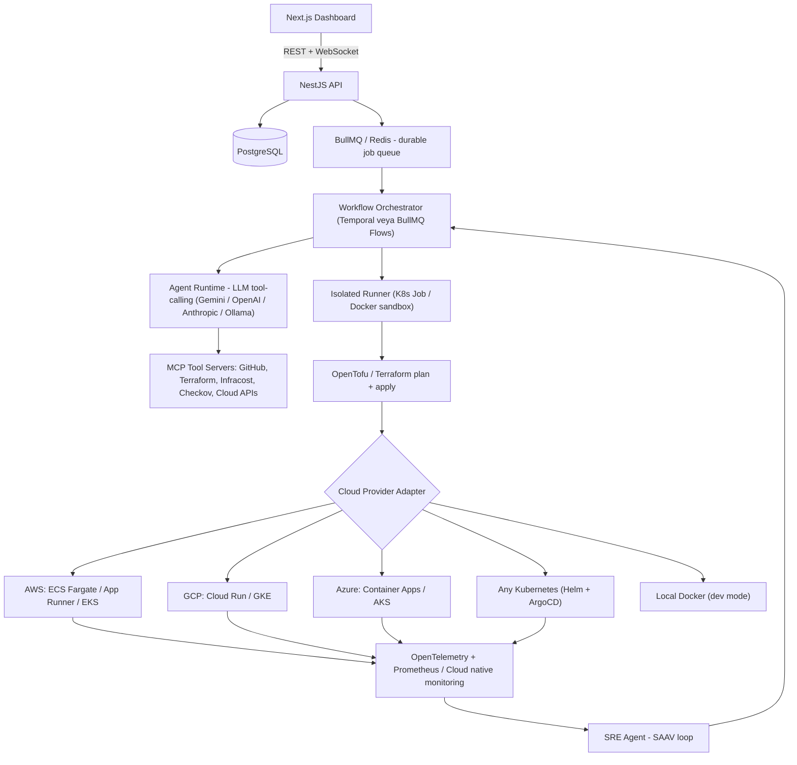
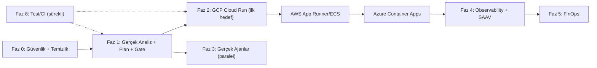

# 🪐 Orbitron — Master Plan (Amaç, Gerçek Durum Analizi ve A'dan Z'ye Yapılacaklar)

> Bu doküman `ORBITRON_PRODUCTION_PLAN.md` dosyasının yerini alır. Projenin **gerçek** durumunu (neyin çalıştığını, neyin simülasyon olduğunu) dürüstçe ortaya koyar ve Orbitron'u **kullanılabilir, multi-cloud bir ürüne** dönüştürmek için gereken tüm işleri öncelik sırasıyla listeler.
>
> Son güncelleme: 2026-11-07

---

## 1. Ürünün Amacı (Tek Cümle)

**"Repo'nu ver, gerisini ajanlar yapsın."** — Orbitron, bir Git reposunu analiz edip seçilen bulutta (AWS / GCP / Azure / Kubernetes) güvenli ve bütçeye uygun altyapıyı kuran, CI/CD'yi bağlayan, maliyeti izleyen ve production'daki olayları kendi kendine iyileştiren çok ajanlı bir DevOps platformudur.

### Hedef kullanıcı ve temel iş akışı

| # | Adım | Kullanıcının beklentisi |
|---|------|-------------------------|
| 1 | **Connect** | GitHub/GitLab hesabını ve bulut hesabını (OIDC ile, anahtarsız) bağlar |
| 2 | **Analyze** | Repo gerçekten taranır: dil, framework, port, env değişkenleri, DB ihtiyacı |
| 3 | **Plan** | Seçilen bulut için IaC (Terraform/OpenTofu) + Dockerfile + CI/CD üretilir, **diff olarak** gösterilir |
| 4 | **Gate** | Checkov/Trivy güvenlik + Infracost maliyet kapısı; bütçe aşılırsa durur |
| 5 | **Approve** | Human-in-the-loop: kullanıcı planı onaylar (veya auto-approve politikası) |
| 6 | **Apply** | İzole runner'da `tofu apply`, image build & push, deploy |
| 7 | **Verify** | Healthcheck + smoke test; başarısızsa otomatik rollback |
| 8 | **Operate** | Gerçek metrikler, alarmlar, SAAV self-healing, FinOps önerileri |
| 9 | **Deliver** | Üretilen dosyalar kullanıcının reposuna **Pull Request** olarak açılır |

---

## 2. Gerçek Durum Analizi (Dürüst Envanter)

### 2.1 Gerçekten çalışanlar ✅

- NestJS API + Prisma/PostgreSQL: auth (JWT), kullanıcı/organizasyon, plan & kota, deployment kayıtları, incident kayıtları, aktivite akışı, token kullanım kaydı.
- Next.js dashboard: tüm sayfalar render oluyor, polling + SSE/WebSocket ile canlı güncelleniyor.
- GitHub: OAuth (yapılandırılırsa), kullanıcı adı ile public repo listesi, PAT ile private repo listesi; deploy sırasında repo metadata + kök dosya listesi okunuyor.
- Lokal Docker: `nginx:alpine` container'ı gerçekten ayağa kalkıyor, durumu/logları `docker inspect/logs` ile okunuyor, durdurulabiliyor.
- Üretilen dosya paketi (Dockerfile, compose, Terraform, GitHub Actions, K8s manifest, CloudWatch alarm) görüntülenip indirilebiliyor.
- Prometheus `/api/metrics` endpoint'i, health/readiness probe'ları.

### 2.2 Simülasyon / sahte olanlar ⚠️ (kullanılabilirliği öldüren kısım)

| Alan | Bugünkü gerçek | Neden sorun |
|------|----------------|-------------|
| **Ajanlar** | Kubernetes'te kagent yoksa ya statik mock adımlar dönüyor ya da Gemini'ye tek prompt atılıp "4 adım uydur" deniyor. Model parametresi yok sayılıyor (`gemini-2.5-flash` sabit). Hiçbir ajan gerçek tool çağırmıyor. | Ajan çıktıları dekoratif; karar mekanizması yok. |
| **IaC** | Terraform dosyaları string şablonlarından üretiliyor; `terraform validate/plan/apply` hiç çalışmıyor. | Kullanıcı üretilen kodun çalışacağından emin olamaz. |
| **Checkov / Infracost / OPA** | Sonuçlar metin olarak yazılıyor ("24 passed"), araçlar çalıştırılmıyor. | Güvenlik ve maliyet kapısı gerçek değil. |
| **Maliyet** | Ortama göre sabit sayı (38.5 / 64 / 92.4 $) veya bütçe × 0.88. FinOps "Apply" butonu DB'deki maliyeti çarpanla düşürüyor, durum bellek içinde. | Yanıltıcı finansal veri. |
| **"Real container"** | Kullanıcının uygulaması değil, proje adını gösteren bir HTML sayfası nginx içinde servis ediliyor. | "Deploy ettim" hissi veriyor ama uygulama deploy edilmiyor. |
| **Self-healing** | Incident 8 sn sonra başlıktaki anahtar kelimeye göre hazır metinle "resolved" yapılıyor. | Gerçek metrik/aksiyon yok. |
| **Sistem metrikleri** | `cost-monitor` CPU/mem/req `Math.random()` ile üretiliyor. | Dashboard grafikleri anlamsız. |
| **Rollback / Promote** | Yeni bir deployment kaydı oluşturuyor; artefakt/sürüm kavramı yok. | Gerçek sürüm yönetimi yok. |
| **K8s topoloji sayfası** | Sabit pod listesi, istemci tarafı state. | Gerçek cluster ile bağlantısız. |

### 2.3 Kullanılmayan / yarım bileşenler 🧩

- **RabbitMQ** docker-compose'da var, kodda hiç kullanılmıyor. `ioredis` bağımlılığı var, kullanılmıyor.
- **`orchestrator/` (Python)** — `agent_registry.py`, `orchestrator.py` backend'e bağlı değil.
- **`.agent/skills/*`** — IDE ajan skill'leri; ürün runtime'ı bunları kullanmıyor.
- **`k8s/`, `infrastructure/lambda`, `policies/finops`** — dokümante edilmiş ama otomatik akışta kullanılmıyor.
- Test kapsamı fiilen sıfır (sadece iskelet `app.controller.spec.ts` ve `app.e2e-spec.ts`).

### 2.4 Güvenlik açıkları 🔴 (öncelikli)

1. **Kota bypass:** `deployments.service.ts` ve `settings.service.ts` içinde e-postası `bugrahan` içeren **herkes** sınırsız deploy hakkı alıyor (`foo+bugrahan@x.com` ile kayıt olan biri dahil). → Rol tabanlı (`role = 'admin'`) yetkiye taşınmalı.
2. **Varsayılan JWT secret:** `JWT_SECRET` yoksa koda gömülü sabit anahtar kullanılıyor. Production'da env yoksa uygulama **başlamamalı**.
3. **Varsayılan şifreleme anahtarı:** GitHub token'ları `ENCRYPTION_KEY` yoksa sabit anahtarla AES'leniyor; ayrıca `crypto-js` yerine Node `crypto` (AES-256-GCM) kullanılmalı.
4. **Komut enjeksiyonu riski:** `exec()` ile shell string'i kuruluyor. Değişkenler şu an sanitize edilmiş ID'lerden geliyor ama `execFile`/Docker Engine API (dockerode) kullanılmalı.
5. **Docker socket mount:** API container'ına `/var/run/docker.sock` bağlamak host'ta root eşdeğeri yetki demek. Sadece lokal geliştirme modunda açık olmalı; prod'da izole runner (K8s Job / Firecracker / gVisor) kullanılmalı.
6. **GitHub OAuth `state`** parametresi doğrudan `userId` — CSRF koruması yok; imzalı/tek kullanımlık state gerekli.
7. Rate limiting, request validation (`class-validator` DTO'ları çoğu endpoint'te yok), audit log eksik.

### 2.5 Teknik borç

- Next 16 + React 18 uyumsuzluğu (App Router React 19 bekliyor), Prisma 5 → 6, Tailwind 3 → 4.
- Frontend'de tüm stiller inline; ortak component kütüphanesi yok, sayfalar 400–800 satır.
- `deployments.service.ts` ~1350 satır; şablonlar, Docker, GitHub ve orkestrasyon tek dosyada.
- Orkestrasyon HTTP isteği içinde fire-and-forget promise; backend restart olursa deployment "running"de takılı kalır.
- Dokümanlar (README, wiki) çalışmayan özellikleri "çalışıyor" gibi anlatıyor.

---

## 3. Hedef Mimari (Multi-Cloud)



### 3.1 `CloudProvider` adaptör sözleşmesi

Her bulut aynı arayüzü uygular; ajanlar buluta özgü detay bilmez:

```ts
interface CloudProvider {
  id: 'aws' | 'gcp' | 'azure' | 'kubernetes' | 'local';
  validateCredentials(cred: CloudCredential): Promise<CredentialCheck>;
  regions(): Promise<Region[]>;
  recommendTarget(repo: RepoAnalysis, env: Environment): ComputeTarget; // Cloud Run vs ECS vs Container Apps...
  generateIaC(plan: DeploymentPlan): Promise<IaCBundle>;            // OpenTofu modülleri
  estimateCost(bundle: IaCBundle): Promise<CostReport>;             // Infracost (AWS/GCP/Azure destekli)
  deploy(bundle: IaCBundle, image: ImageRef): Promise<DeployResult>;
  rollback(release: Release): Promise<DeployResult>;
  metrics(release: Release, window: Duration): Promise<MetricSeries>;
  remediate(action: RemediationAction): Promise<ActionResult>;      // scale, restart, rollback
  destroy(release: Release): Promise<void>;
}
```

### 3.2 Bulut eşleme tablosu

| Kavram | AWS | GCP | Azure | Kubernetes |
|--------|-----|-----|-------|------------|
| Basit container | App Runner / ECS Fargate | Cloud Run | Container Apps | Deployment + Service |
| Orkestrasyon | EKS | GKE Autopilot | AKS | — |
| Registry | ECR | Artifact Registry | ACR | GHCR / Harbor |
| PostgreSQL | RDS / Aurora Serverless v2 | Cloud SQL | Flexible Server | CloudNativePG |
| Secrets | Secrets Manager | Secret Manager | Key Vault | External Secrets |
| Metrikler | CloudWatch | Cloud Monitoring | Azure Monitor | Prometheus |
| Anahtarsız kimlik | IAM OIDC role | Workload Identity Federation | Federated Credential | ServiceAccount |
| IaC provider | `hashicorp/aws` | `hashicorp/google` | `hashicorp/azurerm` | `helm` / `kubernetes` |

---

## 4. A'dan Z'ye Yapılacaklar

Öncelik: **P0** = kullanılabilirlik/güvenlik için şart · **P1** = MVP · **P2** = rekabetçi ürün · **P3** = vizyon

### Faz 0 — Temizlik ve Güvenlik (1 hafta) · P0

- [x] **A1.** E-posta tabanlı "sınırsız kota" kontrolünü kaldır; `User.plan` (`enterprise`), `ADMIN_EMAILS` ve `OrganizationMember.role` (`owner/admin`) üzerinden yetkilendir (`deployments.service.ts`, `settings.service.ts`).
- [x] **A2.** `JWT_SECRET`, `ENCRYPTION_KEY` yoksa production'da boot'u durdur (`backend/src/common/env.validation.ts`).
- [x] **A3.** `crypto-js` → Node `crypto` AES-256-GCM (`v2:<iv>:<tag>:<cipher>`) + mevcut `CryptoJS` kayıtları için geriye dönük otomatik çözme desteği (`backend/src/common/crypto.util.ts`).
- [x] **A4.** `exec()` kabuk çağrılarını `execFile('docker', [...])` argüman dizisi ile değiştirerek kabuk enjeksiyonu riskini kapat (`deployments.service.ts`).
- [x] **A5.** GitHub OAuth için HMAC-SHA256 imzalı, 10dk süreli `state` (CSRF koruması — `signOAuthState` / `verifyOAuthState`).
- [x] **A6.** Global `ValidationPipe({ whitelist: true, transform: true })` aktif.
- [x] **A7.** Kullanılmayan RabbitMQ servisini `docker-compose.yml` içinden kaldır.
- [x] **A8.** UI ve telemetri yanıtlarında veri kaynağını (`source: 'host-telemetry' | 'recorded'`) açıkça işaretle.
- [x] **A9.** `cost-monitor` içindeki `Math.random()` metriklerini kaldır; Node.js `os.loadavg()`, `os.totalmem()`, `os.freemem()` üzerinden gerçek host telemetrisi döndür.

### Faz 1 — Gerçek Çekirdek Akış: Repo → Plan → Gate (2–3 hafta) · P1

- [x] **B1. Repo Analyzer (gerçek):** GitHub API üzerinden kök dizin ağacını ve `package.json`, `Dockerfile`, `.env.example` içeriklerini deterministik olarak tara (`deepInspectGitHubRepository` — `backend/src/deployments/devops-engine.ts`): runtime, framework, `EXPOSE` portu, build/start komutları, veritabanı bağımlılıkları (`postgresql`, `redis`, `mongodb`, `mysql`) ve monorepo tespiti.
- [ ] **B2. Dockerfile üretimi/doğrulaması:** Mevcutsa Hadolint ile denetle; yoksa dile göre şablon üret; **gerçekten `docker build`** et (runner'da) ve sonucu stage çıktısına yaz.
- [x] **B3. Durable orkestrasyon & Crash Recovery:** `DeploymentsService.onModuleInit` ile sunucu yeniden başlatıldığında yarım kalan `running` dağıtımlarının otomatik kurtarılması/işaretlenmesi; aşama ilerlemelerinin PostgreSQL `stages` kolonuna anlık yazılması.
- [ ] **B4. Prisma şeması genişletme:** `Project`, `Environment`, `Release` (image digest, git sha, IaC hash), `DeploymentStage`, `CloudCredential`, `RepoAnalysis`, `CostReport`, `AuditLog` modelleri; `Deployment.cloudProvider` alanı.
- [x] **B5. IaC modül & Plan Diff üretimi (`buildStructuredPlanDiff`):** Seçilen bulut sağlayıcısına (`aws`, `gcp`, `azure`, `kubernetes`) göre OpenTofu/Terraform kaynak diff listesi (`+create`, `~update`, `-delete`), SHA-256 `iacHash` ve kaynak bazlı maliyet tahmini (`GET /api/deployments/:id/plan-diff`).
- [x] **B6. Güvenlik kapısı (`evaluateSecurityGate`):** Üretilen `Dockerfile`, `terraform/main.tf`, `k8s/manifest.yaml` ve `.github/workflows/orbitron-ci-cd.yml` üzerinde deterministik kural denetimi (`CKV_DOCKER_2`, `CKV_DOCKER_3`, `CKV_DOCKER_8`, `CKV_TF_PIN`, `CKV_K8S_RES`, `CKV_K8S_PROBE`, `CKV_CICD_SCAN`) ve UI'da güvenlik skoru/kontrol tablosu.
- [x] **B7. Multi-Cloud Maliyet Kapısı (`calculateMultiCloudCostReport`):** AWS, GCP, Azure ve Kubernetes için kalem kalem aylık maliyet hesabı, bütçe kontrolü ve bulutlar arası yan yana maliyet/soğuk-başlangıç karşılaştırması.
- [x] **B8. Plan diff ekranı:** Kaynak ekle/değiştir/sil listesi (`+add ~change -destroy`), `iacHash`, maliyet farkı ve güvenlik bulguları `preview/[id]` DevOps IaC Bundle görünümünde gösteriliyor.
- [ ] **B9. PR olarak teslim:** Üretilen Dockerfile / IaC / workflow dosyalarını GitHub App ile kullanıcının reposuna `orbitron/setup` branch'inde PR olarak aç.

### Faz 2 — Multi-Cloud Deploy (3–4 hafta) · P1

- [x] **C1. Provider adaptör katmanı (`backend/src/providers/cloud-provider.registry.ts`):** `aws`, `gcp`, `azure`, `kubernetes` ve `local` sağlayıcı tanımları, bölgeler, servis eşlemeleri ve `GET /api/deployments/providers` kataloğu.
- [x] **C2. Anahtarsız Bulut Kimlik Şablonları (Keyless OIDC):** AWS IAM OIDC, GCP Workload Identity Federation, Azure Entra Federated Credential ve Kubernetes ServiceAccount kurulum CLI snippet'leri (`CLOUD_PROVIDER_CATALOG`).
- [x] **C3. AWS IaC & CI/CD Sentezi:** ECR push + ECS Fargate (ARM64 Graviton2) + RDS PostgreSQL 16 + CloudWatch SAAV alarmları.
- [x] **C4. GCP IaC & CI/CD Sentezi:** Artifact Registry + Cloud Run v2 + Cloud SQL PostgreSQL 16.
- [x] **C5. Azure IaC & CI/CD Sentezi:** Azure Container Registry + Azure Container Apps + PostgreSQL Flexible Server.
- [x] **C6. Kubernetes IaC & CI/CD Sentezi:** Namespace, Deployment, Service, HPA v2 ve `hashicorp/kubernetes` + `hashicorp/helm` sağlayıcıları.
- [ ] **C7. Local Docker modu (gerçek):** nginx placeholder yerine kullanıcının **gerçek image'ını** build edip çalıştır; port'u Dockerfile'dan oku.
- [x] **C8. Bulut karşılaştırma (`calculateMultiCloudCostReport`):** Aynı repo için AWS/GCP/Azure/K8s tahmini maliyet + soğuk başlangıç karşılaştırması ve FinOps en uygun hedef önerisi.
- [x] **C9. Release & rollback (`redeploy`, `promote`, `rollback`):** Sürüm geri alma (`POST /api/deployments/:id/rollback`) ve üst ortama taşıma (`POST /api/deployments/:id/promote`).
- [x] **C10. Destroy (`POST /api/deployments/:id/destroy`):** Ortamı ve çalışan konteynerleri tamamen kaldırma (`tofu destroy`) + aktivite/audit kaydı.

### Faz 3 — Gerçek Ajanlar (paralel, 3 hafta) · P1–P2

- [x] **D1. Dinamik LLM Model Yönlendirmesi (`kagent-bridge.service.ts`):** `AgentConfig.model` ve `maxTokens` parametrelerinin sabit `gemini-2.5-flash` yerine dinamik olarak `@google/genai` çağrısına iletilmesi.
- [ ] **D2. Tool calling + MCP:** Ajanlar şu tool'ları gerçekten çağırsın: `repo.read_file`, `iac.plan`, `security.scan`, `cost.estimate`, `cloud.metrics`, `cloud.scale`, `deploy.rollback`. Resmi MCP sunucuları (GitHub, Terraform, AWS/GCP/Azure) desteklensin.
- [ ] **D3. Ajan rolleri netleşsin:** Ajanlar şablon üretmez; deterministik pipeline'ın **karar noktalarında** devreye girer (hedef seçimi, Dockerfile düzeltme, build hatası analizi, Checkov bulgusu düzeltme önerisi, incident RCA).
- [ ] **D4. Guardrail'ler:** Ajan yalnızca izinli tool'ları çağırabilir; yıkıcı aksiyonlar (destroy, prod scale-down) her zaman onay ister; tüm tool çağrıları `AgentExecution` + `AuditLog`'a yazılır.
- [ ] **D5. Token bütçesi gerçek kesintisi:** Organizasyon token limiti aşıldığında ajan çağrısı reddedilsin, ucuz modele düşsün.
- [ ] **D6. Değerlendirme seti:** 10–20 örnek repo (Node, Python, Go, Next.js, monorepo) ile otomatik "analiz → plan → validate" regresyon testi.

### Faz 4 — Gözlemlenebilirlik ve Self-Healing (2–3 hafta) · P2

- [ ] **E1. OpenTelemetry:** Orbitron backend'i ve deploy edilen uygulamalar için OTel collector; trace/metric/log tek yerde.
- [ ] **E2. Gerçek metrik okuma:** CloudWatch / Cloud Monitoring / Azure Monitor / Prometheus adaptörleri; dashboard grafikleri gerçek seriyle.
- [ ] **E3. Alarm → Incident:** Bulut alarmları webhook ile (EventBridge, Pub/Sub, Action Group, Alertmanager) Orbitron'a gelsin, otomatik incident açılsın.
- [ ] **E4. SAAV gerçek döngü:** Sense (metrik) → Analyze (LLM RCA + log örnekleri) → Act (politikaya göre: scale, restart, rollback) → Verify (metrik normale döndü mü?) → incident'a zaman çizelgesi yaz. Aksiyon başarısızsa insana eskale et.
- [ ] **E5. Remediation politikaları:** Kullanıcı tanımlı runbook'lar (YAML): "5xx > %5, 3 dk → son release'e rollback".
- [ ] **E6. Bildirimler:** Slack / Discord / Teams / PagerDuty / e-posta kanalları gerçek gönderim + test butonu (altyapı mevcut, uçtan uca doğrulanmalı).

### Faz 5 — FinOps (2 hafta) · P2

- [ ] **F1.** Gerçek harcama verisi: AWS Cost Explorer / GCP Billing Export (BigQuery) / Azure Cost Management.
- [ ] **F2.** Tahmin vs gerçek karşılaştırması, anomali tespiti, aylık projeksiyon.
- [ ] **F3.** Öneriler gerçek kaynaklara bağlı (idle kaynak, rightsizing, Spot/Graviton, Savings Plan) ve "Apply" = IaC değişikliği + PR + plan/approve akışı.
- [ ] **F4.** Organizasyon / proje / ortam bazında bütçe ve alarm; OPA/Rego politikaları (`policies/finops`) gerçekten değerlendirilsin.

### Faz 6 — Ürün ve UX (sürekli) · P1–P2

- [ ] **G1. Onboarding sihirbazı:** "Repo bağla → bulut seç → bütçe gir → ilk deploy" 4 adım; boş durum ekranları.
- [ ] **G2. Proje merkezli bilgi mimarisi:** Project → Environments (dev/staging/prod) → Releases → Stages; şu anki sayfa dağınıklığı (Pipeline vs Deployments) birleştirilsin.
- [ ] **G3. Canlı stage logları:** Her stage için gerçek runner logu (WebSocket stream), indirilebilir.
- [ ] **G4. Design system:** shadcn/ui + Tailwind 4; inline stillerin kaldırılması; dark/light tema; erişilebilirlik (a11y).
- [ ] **G5.** i18n (TR/EN), klavye kısayolları, komut paleti (⌘K).
- [ ] **G6.** Sahte K8s topoloji sayfasını gerçek cluster verisine bağla veya kaldır.

### Faz 7 — Platform ve SaaS Hazırlığı · P2

- [ ] **H1.** RBAC: organizasyon rolleri, ortam bazlı yetki (prod'a sadece admin deploy).
- [ ] **H2.** SSO (OIDC/SAML), 2FA.
- [ ] **H3.** Audit log ekranı + dışa aktarma.
- [ ] **H4.** Stripe production: Price ID'ler, webhook (subscription created/updated/deleted), fatura sayfası; plan limitlerinin tek kaynaktan (DB) yönetimi.
- [ ] **H5.** Public REST API + API key + OpenAPI (Swagger) dokümanı; CLI (`orbitron deploy`).
- [ ] **H6.** GitLab ve Bitbucket desteği.

### Faz 8 — Kalite, Test ve CI/CD · P0–P1 (her fazla paralel)

- [ ] **I1.** Backend birim testleri (servisler) — hedef %60+ kapsama.
- [ ] **I2.** E2E: Testcontainers (Postgres + Redis) ile API akış testleri.
- [ ] **I3.** Frontend: Playwright ile kritik akışlar (register → repo bağla → deploy → plan onay).
- [ ] **I4.** CI: lint + typecheck + test + build + Trivy image scan + CodeQL (mevcut) + Checkov (infra klasörü).
- [ ] **I5.** CD: GHCR image'ları cosign ile imzala, SBOM (Syft) üret; Helm chart ile Orbitron'un kendisini deploy et.
- [ ] **I6.** Preview environment: her PR için geçici ortam.

### Faz 9 — Teknoloji Yenileme · P1

| Mevcut | Hedef | Gerekçe |
|--------|-------|---------|
| React 18 + Next 16 | **React 19** + Next 16 | App Router uyumu, Server Actions |
| Prisma 5 | **Prisma 6** | Performans, typed SQL |
| Tailwind 3 + inline style | **Tailwind 4 + shadcn/ui** | Tutarlı UI, daha az kod |
| fire-and-forget promise | **BullMQ** (Redis) veya **Temporal** | Dayanıklı iş akışları |
| RabbitMQ (kullanılmıyor) | Kaldır | Gereksiz bileşen |
| Terraform şablon string | **OpenTofu** modülleri + runner | Açık kaynak, doğrulanabilir |
| Tek LLM (Gemini sabit) | **Vercel AI SDK** çoklu sağlayıcı + Ollama | Vendor bağımsızlık, on-prem |
| `crypto-js` | Node `crypto` | Güvenlik |
| `exec()` Docker | **dockerode** | Güvenlik, hata yönetimi |
| Kendi metrik üretimi | **OpenTelemetry** | Standart |
| Swagger yok | **@nestjs/swagger** | API dokümanı |
| kagent (opsiyonel) | Koru, ama opsiyonel runtime olarak | K8s-native ajan çalıştırma |

### Faz 10 — Dokümantasyon · P0

- [ ] **J1.** README: gerçek durum tablosu (✅ çalışıyor / 🧪 simüle / 🗺️ planlı) — *bu commit ile yapıldı*.
- [ ] **J2.** `docs/architecture.md`: hedef multi-cloud mimari — *bu commit ile yapıldı*.
- [ ] **J3.** Wiki sayfalarını gerçek durumla senkronize et (özellikle Agents, Actions, Insights).
- [ ] **J4.** `docs/getting-started.md`: 10 dakikada lokal kurulum + ilk deploy.
- [ ] **J5.** `docs/cloud-setup/{aws,gcp,azure}.md`: anahtarsız kimlik kurulumu adım adım.
- [ ] **J6.** `.env.example` içindeki her değişkenin açıklaması ve zorunlu/opsiyonel bilgisi.
- [ ] **J7.** ADR (Architecture Decision Records) klasörü: kuyruk seçimi, IaC aracı, LLM soyutlaması.

### Vizyon (Faz 11+) · P3

- [ ] **Z1.** BYOA — kendi ajanını getir (marketplace, izole namespace).
- [ ] **Z2.** Air-gapped / on-prem kurulum (yerel LLM, Harbor, OpenTofu mirror).
- [ ] **Z3.** Doğal dil ile altyapı değişikliği ("staging'i Avrupa'ya taşı, maliyeti %20 düşür").
- [ ] **Z4.** Çoklu bölge / çoklu bulut aktif-aktif ve otomatik failover.

---

## 5. Önerilen Sıralama ve MVP Tanımı



**MVP "kullanılabilir" kabul kriteri:** Bir kullanıcı public bir Node.js veya Python reposunu bağlayıp, GCP/AWS/Azure'dan birini seçip, gerçek `plan` + Checkov + Infracost sonuçlarını görüp onayladığında, uygulaması **gerçek bir public URL'de** çalışıyor olmalı; ikinci bir commit'te yeni release çıkmalı ve tek tıkla önceki release'e dönülebilmeli.

---

## 6. Başarı Metrikleri

| Metrik | Hedef |
|--------|-------|
| Repo bağlamadan ilk canlı URL'e süre | < 10 dk |
| Örnek repo setinde başarılı analiz oranı | > %90 |
| Üretilen IaC'nin `tofu validate` geçme oranı | %100 |
| Tahmini vs gerçek maliyet sapması | < %15 |
| Self-healing ile otomatik çözülen incident oranı | > %50 (kurallı senaryolarda) |
| Backend test kapsamı | > %60 |

