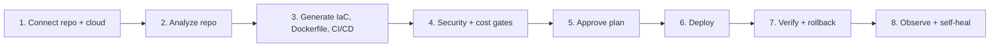
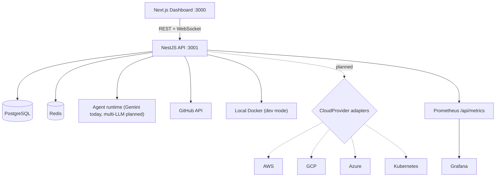

# 🪐 Orbitron — Autonomous Multi-Cloud DevOps Platform

[](https://github.com/bugrasurucu/autonomous-devops-platform/actions/workflows/ci.yml)
[](https://github.com/bugrasurucu/autonomous-devops-platform/actions/workflows/cd.yml)
[](https://github.com/bugrasurucu/autonomous-devops-platform/actions/workflows/codeql.yml)

> **Point it at a repo, pick a cloud, and let the agents do the rest.**

Orbitron is a multi-agent DevOps platform. It analyzes a Git repository, generates infrastructure-as-code, CI/CD, and container configuration for your target cloud (**AWS, GCP, Azure, or any Kubernetes cluster**), enforces security and cost gates, deploys, and then watches production with a self-healing SRE loop.

> [!IMPORTANT]
> **Project status: early alpha.** The end-to-end UI flow works, but several stages are still **simulated**. Read the [status table](#-what-works-today) before relying on it, and see the [Master Plan](ORBITRON_MASTER_PLAN.md) for the roadmap.

---

## ✨ How it works



Five specialized agents run the pipeline in sequence:

| Agent | Responsibility |
|-------|----------------|
| 🔍 **Bootstrap** | Scans the repo: language, framework, ports, Dockerfile, database needs |
| 🏗️ **Infra** | Produces Terraform/OpenTofu for the selected cloud and runs security checks |
| 💰 **FinOps** | Estimates monthly cost and blocks deployments that exceed the budget |
| ⚡ **Pipeline** | Generates Dockerfile, docker-compose, GitHub Actions, and Kubernetes manifests |
| 🛡️ **SRE** | Configures alarms and runs the Sense → Analyze → Act → Verify (SAAV) healing loop |

---

## 📊 What works today

| Capability | Status | Notes |
|------------|:------:|-------|
| Auth, organizations, plans, quotas | ✅ | JWT, PostgreSQL via Prisma |
| GitHub connection | ✅ | OAuth (if configured), username (public repos), or Personal Access Token |
| Repo metadata + root file scan | ✅ | Via GitHub REST API |
| 5-stage pipeline UI with per-stage output | ✅ | Live updates over WebSocket/SSE |
| Generated DevOps bundle (6 files) | ✅ | Dockerfile, compose, Terraform, GitHub Actions, K8s manifest, CloudWatch alarms. View, copy, and download them. |
| Redeploy / promote / rollback actions | ✅ | Currently creates a new deployment record (release versioning is planned) |
| Local Docker container | 🧪 | Real `nginx:alpine` container with a generated status page. It does **not** run your app yet. |
| Agent reasoning | 🧪 | Gemini-generated or mock steps. Agents don't call real tools yet. |
| Checkov / Infracost / OPA gates | 🧪 | Results are templated. The tools are not executed yet. |
| Cost estimates and FinOps "Apply" | 🧪 | Heuristic numbers per environment |
| Self-healing incidents | 🧪 | Auto-resolved after a SAAV timer with rule-based RCA text |
| System metrics charts | 🧪 | Synthetic data |
| AWS deploy (ECS / App Runner) | 🗺️ | Planned (Phase 2) |
| GCP deploy (Cloud Run) | 🗺️ | Planned (Phase 2, first target) |
| Azure deploy (Container Apps) | 🗺️ | Planned (Phase 2) |
| Any Kubernetes (Helm / ArgoCD) | 🗺️ | Planned (Phase 2) |
| Keyless cloud auth (OIDC / Workload Identity) | 🗺️ | Planned (Phase 2) |

✅ working · 🧪 simulated · 🗺️ planned

---

## ☁️ Multi-cloud target matrix

| Concept | AWS | GCP | Azure | Kubernetes |
|---------|-----|-----|-------|------------|
| Simple container | App Runner / ECS Fargate | Cloud Run | Container Apps | Deployment + Service |
| Registry | ECR | Artifact Registry | ACR | GHCR / Harbor |
| PostgreSQL | RDS / Aurora Serverless v2 | Cloud SQL | Flexible Server | CloudNativePG |
| Secrets | Secrets Manager | Secret Manager | Key Vault | External Secrets |
| Monitoring | CloudWatch | Cloud Monitoring | Azure Monitor | Prometheus |
| Keyless identity | IAM OIDC role | Workload Identity Federation | Federated Credential | ServiceAccount |

All clouds sit behind a single `CloudProvider` adapter interface, described in [docs/architecture.md](docs/architecture.md).

---

## 🏗️ Architecture



**Stack:** NestJS 11 · Next.js 16 · TypeScript · PostgreSQL 16 · Prisma · Redis · Socket.IO · Docker · Prometheus · Grafana · Google Gemini (`@google/genai`) · optional kagent on Kubernetes

The planned stack upgrades (React 19, Prisma 6, Tailwind 4 + shadcn/ui, BullMQ/Temporal, OpenTofu, OpenTelemetry, Vercel AI SDK) are listed in [Master Plan, Phase 9](ORBITRON_MASTER_PLAN.md#faz-9--teknoloji-yenileme--p1).

---

## 🛠️ Quick start

### Prerequisites

- Node.js 20+
- Docker Desktop (or Docker Engine) running
- *(Optional)* A `GEMINI_API_KEY` for LLM-generated agent reasoning

### Option 1: Docker Compose

```bash
cp .env.example .env        # set JWT_SECRET, ENCRYPTION_KEY, GEMINI_API_KEY
docker compose up --build -d
```

| Service | URL |
|---------|-----|
| Dashboard | http://localhost:3000 |
| API | http://localhost:3001/api |
| Prometheus | http://localhost:9090 |
| Grafana | http://localhost:3002 |

### Option 2: Local development

```bash
# 1. Data services
docker compose up postgres redis -d

# 2. Backend
cd backend
npm install
npx prisma db push
npm run start:dev          # http://localhost:3001

# 3. Frontend (new terminal)
cd frontend
npm install
npm run dev                # http://localhost:3000
```

### Try the flow

1. Register at `http://localhost:3000`.
2. **Repositories** → **Connect GitHub** → enter a GitHub username (or a PAT for private repos).
3. Select a repo, then click **Deploy**.
4. **Pipeline**: watch the 5 stages and expand each stage's output.
5. **Deployments** → **Live & IaC**: launch the local container, then open the **DevOps IaC & Files** tab to download the generated bundle.
6. **Self-Healing** → **Simulate Incident**: watch the SAAV loop.

> [!WARNING]
> Local container mode needs access to the Docker socket. Only enable it on a development machine. Mounting `/var/run/docker.sock` gives root-equivalent access to the host.

---

## 📡 API reference

<details>
<summary>Click to expand the endpoint list</summary>

| Method | Endpoint | Description |
|--------|----------|-------------|
| POST | `/api/auth/register` | Create account |
| POST | `/api/auth/login` | Log in (returns JWT) |
| GET | `/api/auth/me` | Current session |
| PUT | `/api/auth/profile` | Update profile |
| PUT | `/api/auth/plan` | Change plan |
| POST | `/api/auth/change-password` | Change password |
| GET | `/api/auth/export` | Export account data |
| DELETE | `/api/auth/account` | Delete account |
| GET | `/api/health`, `/api/health/ready` | Liveness / readiness |
| GET | `/api/stats` | Dashboard statistics |
| GET | `/api/activities` | Persisted activity feed |
| GET | `/api/agents` | List agents |
| POST | `/api/agents/:id/trigger` | Run an agent with a custom task |
| GET | `/api/agents/:id/executions` | Execution history and steps |
| POST | `/api/deploy` | Start the 5-stage multi-cloud pipeline (`aws`, `gcp`, `azure`, `kubernetes`) |
| GET | `/api/deployments/providers` | Cloud provider catalog, regions, and keyless OIDC setup templates |
| GET | `/api/deployments` | Deployment history |
| GET | `/api/deployments/:id` | Deployment detail |
| GET | `/api/deployments/:id/artifacts` | Generated 6-file DevOps bundle + security gate + multi-cloud cost report + OpenTofu plan diff |
| GET | `/api/deployments/:id/plan-diff` | OpenTofu / Terraform resource diff (`+add ~change -destroy`), `iacHash`, and security/cost gates |
| POST | `/api/deployments/:id/stop` | Cancel a running pipeline |
| POST | `/api/deployments/:id/redeploy` | Re-run with the same config |
| POST | `/api/deployments/:id/promote` | Promote dev → staging → production |
| POST | `/api/deployments/:id/rollback` | Restore the last successful config |
| POST | `/api/deployments/:id/destroy` | Decommission environment (`tofu destroy`) and stop active containers |
| POST | `/api/deployments/:id/live-container` | Start the local Docker container |
| GET | `/api/deployments/:id/container-status` | Container state and logs |
| POST | `/api/deployments/:id/stop-container` | Stop the local container |
| DELETE | `/api/deployments/:id` | Delete a deployment |
| GET | `/api/github/oauth-url` | OAuth URL and whether OAuth is configured |
| POST | `/api/github/connect` | Connect with a username or PAT |
| GET | `/api/github/status`, `/api/github/repos` | Connection status and repositories |
| GET | `/api/finops` | Cost overview and recommendations |
| POST | `/api/finops/optimize/:id` | Apply a recommendation |
| GET | `/api/cost/usage`, `/api/cost/suggestions` | Usage and suggestions |
| GET | `/api/token-usage` | LLM token usage |
| GET | `/api/incidents`, `/api/incidents/stats` | Incidents |
| POST | `/api/incidents/simulate` | Simulate an incident |
| POST | `/api/incidents/:id/auto-heal` | Run the SAAV remediation now |
| POST | `/api/incidents/:id/resolve` | Resolve manually |
| GET | `/api/tenants/me` | Organization and members |
| POST | `/api/tenants/:id/members` | Invite a member |
| GET | `/api/billing/plans`, POST `/api/billing/checkout` | Plans and upgrade |
| GET | `/api/notifications/channels` | Alert channels |
| GET | `/api/logs/stream` | SSE log stream |
| GET | `/api/metrics` | Prometheus scrape endpoint |

</details>

---

## 🗺️ Roadmap

See **[ORBITRON_MASTER_PLAN.md](ORBITRON_MASTER_PLAN.md)** for the gap analysis and the A-to-Z task list (in Turkish). In short:

1. **Phase 0:** Security hardening and cleanup (role-based quotas, mandatory secrets, `dockerode`)
2. **Phase 1:** Real repo analysis, OpenTofu plan, Checkov + Infracost gates, plan approval, PR delivery
3. **Phase 2:** Multi-cloud deploy: GCP Cloud Run → AWS → Azure → Kubernetes, with keyless auth
4. **Phase 3:** Real tool-calling agents (MCP, multi-LLM, guardrails)
5. **Phase 4–5:** OpenTelemetry, real SAAV self-healing, real billing data
6. **Phase 6–10:** UX overhaul, RBAC/SSO, tests, tech refresh, docs

---

## 📚 Documentation

- [Architecture (current + target multi-cloud)](docs/architecture.md)
- [Master Plan & gap analysis](ORBITRON_MASTER_PLAN.md)
- [Product overview](ORBITRON_PRODUCT_OVERVIEW.md)
- [Wiki portal](docs/wiki/Wiki.md)
- [Contributing](CONTRIBUTING.md) · [Security policy](SECURITY.md) · [Code of conduct](CODE_OF_CONDUCT.md)

## 📄 License

See [LICENSE](LICENSE).
