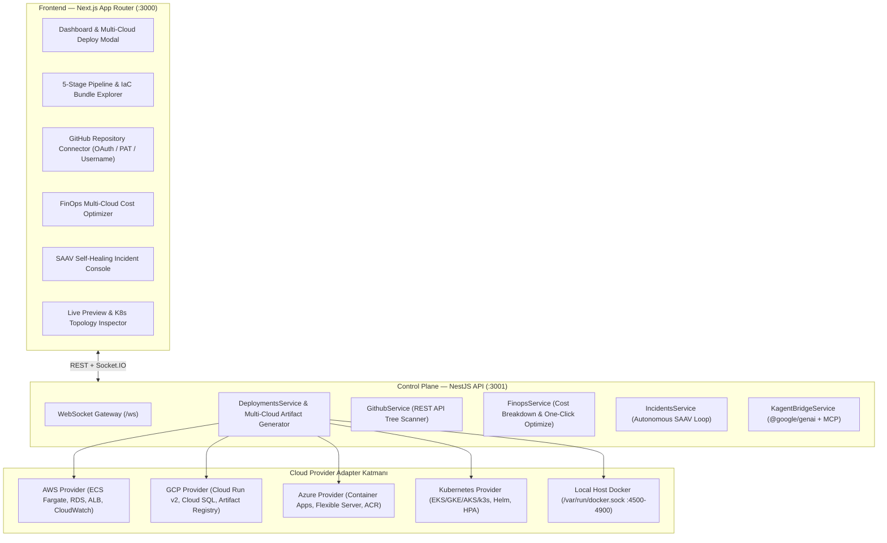

# 🪐 Orbitron Mimari Tasarım Raporu — Multi-Cloud Otonom DevOps Altyapısı

> **Kapsamlı A'dan Z'ye Teknik Yol Haritası ve Eksiklik Analizi için:** [`ORBITRON_MASTER_PLAN.md`](../ORBITRON_MASTER_PLAN.md)

## 1. Genel Vizyon ve Tasarım Prensipleri

Orbitron, **"Drop & Deploy" (Sürükle-Bırak ve Dağıt)** prensibi ile çalışan; GitHub depolarını semantik olarak analiz ederek **Multi-Cloud (AWS, Google Cloud, Microsoft Azure, Kubernetes ve Local Docker)** altyapısı kuran, CI/CD süreçlerini yöneten, FinOps maliyet filtreleri uygulayan ve üretim ortamındaki hataları otonom olarak düzelten (**SAAV Self-Healing**) bir otonom DevOps kontrol düzlemidir (Control Plane).

---

## 2. Çekirdek Sistem Mimarisi

### 2.1 Web UI (`frontend/`)
*   **Teknoloji:** Next.js App Router, TypeScript, Socket.IO Client, Recharts, Lucide Icons.
*   **İşlev:** Multi-Cloud hedef seçimi (AWS / GCP / Azure / Kubernetes), 5 aşamalı canlı pipeline izleme, üretilen 6'lı DevOps IaC paketini görüntüleme/indirme, K8s cluster topoloji simülasyonu ve pod ölçeklendirme, FinOps tek tıkla maliyet optimizasyonu ve SAAV otonom olay iyileştirme konsolu.

### 2.2 Control Plane API Server (`backend/`)
*   **Teknoloji:** NestJS, Prisma ORM, PostgreSQL 16, Redis 7, RabbitMQ 3, `@google/genai`.
*   **İşlev:** JWT kimlik doğrulama, takım ve kota yönetimi, GitHub OAuth / PAT / Username entegrasyonu, gerçek zamanlı GitHub API ağaç taraması (`inspectGitHubRepository`), Multi-Cloud Terraform/CI-CD üretimi ve yerel Docker daemon orkestrasyonu.

### 2.3 5 Uzman Otonom Ajan Filosu (`orchestrator/` & `.agent/skills/`)
Platform, 5 uzman otonom ajanın sıralı orkestrasyonuyla çalışır:

1.  **Auto-Bootstrap Agent:** GitHub API üzerinden depodaki `package.json`, `Dockerfile`, `requirements.txt`, `go.mod`, `prisma/schema.prisma` dosyalarını tarayarak dil, framework, veritabanı ve port gereksinimlerini çıkarır.
2.  **Infra Agent (Multi-Cloud):** Seçilen bulut sağlayıcısına (`aws`, `gcp`, `azure`, `kubernetes`) özgü Terraform/OpenTofu HCL, Kubernetes manifestleri ve `Dockerfile` şablonlarını üretir; güvenlik politikalarını denetler.
3.  **FinOps Agent:** Hedef bulut sağlayıcısının (AWS ECS+RDS, GCP Cloud Run+Cloud SQL, Azure Container Apps+Flexible Server) aylık maliyet kırılımını hesaplar, bütçe korumasını işletir ve tek tıkla mimari maliyet optimizasyonu (`POST /api/finops/optimize/:id`) uygular.
4.  **Pipeline Agent:** Bulut sağlayıcısına özel GitHub Actions CI/CD iş akışı (`.github/workflows/orbitron-ci-cd.yml`) oluşturur, duman testlerini (smoke tests) ve görsel doğrulamayı yürütür.
5.  **SRE Agent:** Olay algılama ve **SAAV (`Sense → Analyze → Act → Verify`)** döngüsüyle konteyner sağlığını izler, anomali durumunda otonom iyileştirme (`POST /api/incidents/:id/auto-heal`) veya sürüm geri alma (`POST /api/deployments/:id/rollback`) gerçekleştirir.

---

## 3. Multi-Cloud Provider Matrisi

Orbitron, dağıtım sırasında seçilen hedef bulut veya bölgeye göre sağlayıcıya özgü IaC ve CI/CD artefaktları üretir:

| Bulut Sağlayıcı | Bölge Örnekleri | Üretilen Terraform Kaynakları | Üretilen CI/CD Hedefi |
| :--- | :--- | :--- | :--- |
| **AWS** | `aws:us-east-1`, `aws:eu-west-1`, `aws:eu-central-1` | `aws_vpc`, `aws_ecs_cluster`, `aws_ecs_service` (Fargate), `aws_db_instance` (PostgreSQL), `aws_lb` | Amazon ECR + ECS UpdateService |
| **Google Cloud (GCP)** | `gcp:us-central1`, `gcp:europe-west1` | `google_cloud_run_v2_service`, `google_sql_database_instance`, `google_artifact_registry_repository` | Google Artifact Registry + Cloud Run Deploy |
| **Microsoft Azure** | `azure:eastus`, `azure:westeurope` | `azurerm_container_app_environment`, `azurerm_container_app`, `azurerm_postgresql_flexible_server`, `azurerm_container_registry` | Azure Container Registry + Container Apps Deploy |
| **Kubernetes (Cloud-Agnostic)** | `k8s:cluster-default` | `kubernetes_deployment`, `kubernetes_service`, `kubernetes_ingress_v1`, `kubernetes_horizontal_pod_autoscaler_v2` | GHCR + `kubectl set image` & Rollout Status |

---

## 4. Host Mode Docker Entegrasyonu

Kullanıcı yerel ortamda gerçek bir konteyner önizlemesi başlattığında (`POST /api/deployments/:id/live-container` veya `spinUpRealContainer`):

1.  API Server, `4500-4900` aralığında benzersiz bir yerel port tahsis eder.
2.  Projenin bilgilerini, canlı durumunu ve interaktif test konsolunu içeren özel önizleme arayüzünü oluşturur.
3.  `docker run -d --name orbitron-live-[id] -p [PORT]:80 nginx:alpine` komutuyla gerçek bir Docker konteyneri başlatır ve içeriği konteynere kopyalar.
4.  Kullanıcı `GET /api/deployments/:id/container-status` ile konteynerin gerçek `docker inspect` durumunu ve `docker logs` çıktılarını izleyebilir veya `POST /api/deployments/:id/stop-container` ile durdurabilir.

---

## 5. Güvenlik, Yönetişim ve Dayanıklılık Modeli

1.  **En Az Yetki Prensibi (Least-Privilege IAM & OIDC):** Bulut dağıtımlarında statik anahtarlar yerine GitHub Actions OIDC (`aws-actions/configure-aws-credentials`, `google-github-actions/auth`, `azure/login`) şablonları üretilir.
2.  **FinOps Devre Kesici (Budget Circuit Breaker):** Tahmini maliyet bütçe limitini aştığında uyarı üretilir ve tek tıkla Graviton / Spot / Scale-to-Zero optimizasyonu uygulanabilir.
3.  **SAAV Otonom İyileştirme:** Açık incident kayıtları 4 aşamalı `Sense → Analyze → Act → Verify` döngüsüyle otomatik veya manuel tetiklemeyle (`POST /api/incidents/:id/auto-heal`) çözümlenir.
